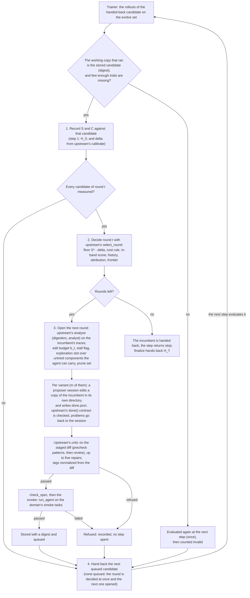

# RRSI Adapter

RRSI Adapter is RRSI (Xia et al., 2026, [arXiv:2609.24972](https://arxiv.org/abs/2609.24972);
[code](https://github.com/google-research/rrsi)), regularized recursive self-improvement of agent harnesses, with the
harness confined to the adapter, as [Meta-Harness Adapter](meta_harness_adapter.md) confines Meta-Harness. Each round
an analyst reports the incumbent's failures from its own evaluation; m proposer sessions edit the incumbent under an
annealed edit budget, with the edit history, an exploration slot when the run stalls, and a list of components to
prune; a critic reads each diff before any evaluation is spent; each screened candidate is evaluated on the whole
evolve set, and replaces the incumbent only above a noise-adjusted floor and within a cost rule. Choose it when you
want harness evolution that resists overfitting its own evolve set and keeps the harness's token cost in check, and
you have the budget to evaluate every candidate on the whole training split with k trials per task.

**What it is not.** RRSI evolves the harness program itself (in its coding instance, a fork of Terminus-2: its loop,
parsers, prompts and tools). Here the acting agent and its host are fixed, and the edits are to the adapter: the
instructions, and the skills, roles, hooks and helper files the agent receives. Results of this method are results
of RRSI's search over adapters under a fixed agent, not of RRSI itself.

## Setup

```yaml
template: rrsi-adapter
start_from: seed_adapter         # H_0
evolver:
  name: rrsi_adapter
  params:
    model: gpt-5.6-luna          # the proposer and the one-call roles (Codex sessions)
    domain: domain.py:MyDomain   # the benchmark's texts and rules (an AdapterDomain)
    rrsi: rrsi.json              # RRSI's hyperparameters (upstream's RRSIConfig fields)
data:
  step_size: 178                 # the whole evolve set (k rows per task, `<task>#<k>`) per step
  shuffle: false
trainer:
  epochs: 41                     # 1 + T x m: H_0, then each candidate once
  allow_early_stop: true         # the Evolver ends the run after round T-1
```

It needs the `rrsi` dependency group (`python -m pip install -e . --group rrsi`): upstream's package at a pinned
commit, whose code runs unchanged for every rule and for the analyst and the critic.

## The template

`rrsi-adapter` fixes only `.hermit/`, as `meta-harness-adapter` does: every other file of the adapter may be added,
changed or removed, with no declared structure, check of its own or exports. Its guide, `EVOLVER.md`, says what an
adapter is, that `ADAPTER.md` is the agent's instructions at the start of every task and that anything else reaches
the agent only if it is told what is there, and names RRSI's component vocabulary K (`prompt`, `control_flow`,
`output_plumbing`, `context_mgmt`, `config`, `client_tool`, `skill`, `memory`, `subagent`) with what an edit of each
must show in the diff, because the tag a proposer gives an edit is checked against the diff. No existing template
names the vocabulary, and the method's history, exploration and pruning are kept per component.

## One framework step

One step evaluates one candidate (`data.step_size` covers the evolve set, k rows per task, so a step is an epoch):



1. The step's rollouts are the evaluation of the candidate handed back last time (the starting adapter, H_0, on the
   first step). They are credited to it only when the working copy that ran has the stored candidate's digest; an
   evaluation with more missing trials than `invalid_missing_frac` (or one the Trainer repaired) is run once more,
   then counted invalid, as upstream does. H_0's evaluation seeds the frontier, and delta is upstream's `calibrate`
   on it unless the config gives one.
2. When every candidate of the round is measured, upstream's `select_round` decides it: a candidate is admissible
   only above S* - delta and within the cost rule, and the best admissible one becomes the incumbent; the history
   L_t, the attribution of each edit's predictions and the frontier are upstream's records.
3. While rounds are left, the next one is opened: upstream's analyst reads the incumbent's own evaluation (each
   task's trajectories rendered, digested per task, then ranked into failure modes, capability gaps and habits to
   keep), and upstream's schedule and history give the edit budget, the stall flag with its reserved exploration
   slot, and the components to prune. Each of the m variants is a proposer session on a copy of the incumbent; its
   `done.json` must meet upstream's `done()` contract, its diff must pass upstream's critic (with up to five repairs
   in the same session), its tags are normalized from the diff, and it must pass `check_spec` and the smoke.
4. The next stored candidate is handed back and the next step evaluates it. A refused candidate costs no step; a
   round with none left is decided at once. After round T-1 the incumbent is handed back, the step returns `stop`
   (`trainer.allow_early_stop` ends the run), and `finalize` hands back H_T.

## How a run maps onto the Trainer

| RRSI (upstream) | Here |
|---|---|
| `Evaluate(H', D_evolve, k)` | the next step's rollouts: the step's rows are the evolve set with k rows per task, credited to the candidate handed back last only when the working copy that ran is the stored candidate (its digest) |
| baseline and delta (`baseline`, `calibrate(["base"])`) | step 1 evaluates H_0; delta is upstream's `calibrate` on that evaluation when the config gives none |
| `analyze` (analyst and digesters) | upstream's code; its `generate` is one Codex session per call, the digesters' sessions in the round's rendered traces |
| proposer (a JSON-action Claude agent, `done()`) | a Codex or Claude Code session on a copy of the incumbent adapter, writing `done.json`; upstream's `done()` contract is checked and every problem goes back to the same session |
| critic with five repairs, tag validation | upstream's `review` and `normalize`; each objection goes back to the same proposer session with upstream's repair text |
| liveness smoke | `check_spec`, then `run_agent` on the domain's smoke tasks |
| `select_round`, history, attribution, frontier | upstream's code, unchanged; H_{t+1}, S* and the trajectory in `state/rrsi/frontier.json` |
| the result H_T | `finalize` hands back the incumbent |

A run takes 1 + (evaluated candidates) steps, at most 1 + T x m. A candidate the critic, the check or the smoke
refuses costs no step; a round whose candidates all fail is decided at once and the next is opened in the same step.
An evaluation with more missing trials than `invalid_missing_frac` is run once more, then counted invalid, as upstream
does; three failed steps in a row stop the run, as upstream's driver does.

## Parameters and defaults

```{literalinclude} ../../hermit/algorithms/evolvers/rrsi_adapter/evolver.yaml
:language: yaml
```

## Where this integration departs from the paper

| Dimension | The paper | Here | Kind |
|---|---|---|---|
| What the proposer may change | The whole harness program | Every file of the adapter outside `.hermit/`; the acting agent, its loop and the host stay fixed | forced by the framework |
| The proposer | Claude Opus 4.8 in upstream's JSON-action loop | A Codex or Claude Code session with the run's model, upstream's system text, context sections and done() contract | a setting |
| The search roles' model | Claude Opus 4.8 | The run's model, one Codex session per call | a setting |
| Component vocabulary | Signals in the Terminus-2 source | The same K, with signals for adapter files (`domain.ADAPTER_SIGNALS`) | forced by the framework |
| delta | Measured from repeated base evaluations (coding: 0.017) | Upstream's `calibrate` on H_0's one evaluation unless the config gives one (its within-task bootstrap reads low by about sqrt(2) with two trials, as upstream's does) | matched to upstream's driver |
| Unexplored components U_t | K minus the components with a measured edit | The same, without the components the benchmark's agent cannot carry (`AdapterDomain.carriers`; OfficeQA's `deploy: adapter` runs no hooks and no roles): a reserved slot never asks for one | forced by the setting |
| The proposer's isolation | Its own worktree; its JSON actions reach only the harness and the round's traces | Its own working directory (the candidate and the round's context); the learning material, the state, the history, the working copy, the step's logs, the roles' calls and every other variant are hidden by the run's sandbox, and a session refuses to run where they cannot be | matched |
| Candidate files | The worktree's git diff | The diff between the incumbent's stored files and the staged candidate (without byte code, caches, nested repositories and what git would not commit); symbolic links are refused, as in Meta-Harness Adapter | forced by the framework |
| The critic's precheck | Upstream's patterns and the domain's | The same, plus, for OfficeQA, the training answers the judge's feedback has revealed (whole answers and their longer numbers) | the reproduction's |
| The digesters' read-only shell action | Runs on the host | Runs under the run's sandbox with the workspace's records covered | the reproduction's |

## Records to read after a run

| Path | Contents |
|---|---|
| `step_NNNN/output/report.md` | The step: the evaluation recorded, the round decided or opened, the candidate handed back |
| `step_NNNN/output/r<t><v>/session_<n>.jsonl` | The proposer's sessions of a variant |
| `workspace/state/rrsi/` | Upstream's files: `frontier.json`, `calibration.json`, `history.jsonl` (L_t), `attribution.jsonl`, `r<t>/` (the analysis, `directives.json`, each variant's proposal, critic verdicts, diff, smoke, and `decisions.json`) |
| `workspace/state/rrsi_adapter.json` | The pump: phase, round, queue, every candidate with its digest and evaluations |
| `workspace/state/candidates/<id>/adapter/` | Each stored candidate |

## Examples

`examples/officeqa/rrsi_adapter/` runs it on OfficeQA with GPT-5.6-Luna acting and learning through Codex (the luna
column of the example's results): ten rounds of two candidates on the 50 training questions, two trials each. Over
four trainings the final incumbent scores 0.602 on the 172 test questions (0.581–0.622), from 0.378 for its starting
adapter in the same harness: level with GEPA, Meta-Harness Adapter and Harness² on that column and above SkillOpt;
as for the column's other methods, the gain is the answer's form.
